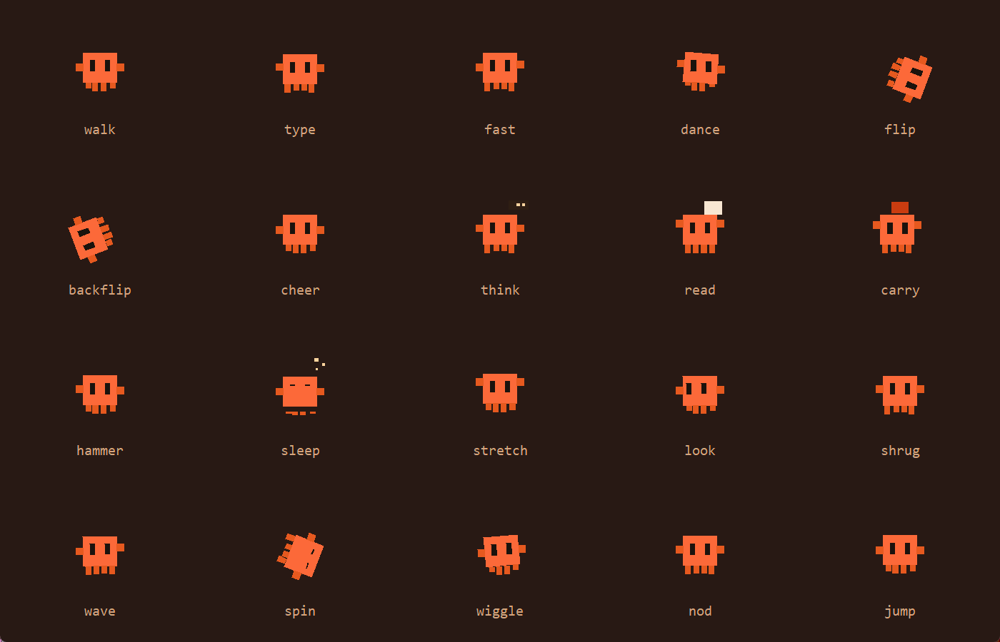

# Clawd Agents

一群 Orange Clawd 像素小人常驻在你的 Windows 桌面上：自由乱跑、偶尔趴到窗口边缘探头、撞见窗口就躲进去、鼠标一靠近就逃。

窗口本身是一个透明无边框的置顶窗口，用色键把背景抠掉，所以桌面上只看得到小人，不会挡住任何东西。



## 特性

- **透明悬浮**：Tkinter `-transparentcolor` 色键透明，品红背景被系统整块抠掉
- **20 种动作**：walk / type / fast / dance / flip / backflip / cheer / think / read / carry / hammer / sleep / stretch / look / shrug / wave / spin / wiggle / nod / jump，按权重随机切换，不是死循环
- **四条腿真的会走**：对角腿交替抬起，跑得越快步频越高
- **四种运动模式**
  - `hide` 捉迷藏（默认）：在桌面上自由乱跑，速度时快时慢；钻进打开的窗口就隐身，躲一会儿再从窗口上沿探出脑袋；鼠标靠近会朝反方向逃
  - `right` 贴着屏幕右边一列跳舞
  - `orbit` 绕屏幕边缘跑一圈
  - `area` 在指定区域里游走
- **点击切窗口**：左键点某个小人，前置它绑定的那个窗口（可在 `config.json` 里按标题关键字绑定）
- **设置面板**：右键 → 设置，可调运动模式、速度、大小、数量、帧率（10–60 FPS）、开机自启动
- **可打包成 exe**：`dist/ClawdAgents.exe` 拿到别的电脑上直接双击就能跑

## 运行

需要 Python 3.10+（tkinter 是标准库自带，Windows 官方安装包默认包含），无第三方依赖。

```bash
python clawd_agents.py
```

也可以直接用打包好的 `dist/ClawdAgents.exe`。

## 操作

| 操作 | 作用 |
| --- | --- |
| 左键点小人 | 前置它对应的窗口 |
| 右键任意位置 | 菜单：设置 / 退出 |

设置面板里的改动会立刻生效，并写入可执行文件同目录的 `config.json`。

## 配置

首次运行会在程序同目录生成 `config.json`（也可以从 `config.example.json` 复制一份改）：

```json
{
  "mode": "hide",
  "count": 7,
  "size": 44,
  "speed": 1.0,
  "fps": 60,
  "area": [0.72, 0.08, 0.24, 0.84],
  "targets": []
}
```

| 字段 | 说明 |
| --- | --- |
| `mode` | `hide` / `right` / `orbit` / `area` |
| `count` | 小人数量（1–12） |
| `size` | 小人尺寸（逻辑像素，24–64） |
| `speed` | 运动速度倍率（0.2–3.0） |
| `fps` | 目标帧率（10–60） |
| `area` | `area` 模式的活动区域，取屏幕宽高的比例 `[x, y, w, h]` |
| `targets` | 点击第 N 个小人时前置的窗口标题关键字，例如 `["Visual Studio Code", "Edge"]`，留空则按窗口 Z 序取第 N 个 |

## 打包 exe

```bash
pip install pyinstaller
pyinstaller --onefile --noconsole --name ClawdAgents clawd_agents.py
```

产物在 `dist/ClawdAgents.exe`。

## 浏览器预览

`index.html` 是同一套造型的网页版（SVG + CSS 动画），可以直接用浏览器打开，加上 `?bg` 看深色背景版：

```
index.html?bg
```

## 实现要点

- 透明：`root.overrideredirect(True)` + `-topmost` + `-transparentcolor '#ff00ff'`，Canvas 背景同色
- 绘制：每个小人 9 个 `create_polygon` 部件，绕自身中心旋转以支持翻跟头/转圈
- 遮挡：捉迷藏模式下用 `EnumWindows` + `DwmGetWindowAttribute` 取真实窗口矩形，命中即隐藏；探头时按窗口上沿把下半身裁掉
- 帧率：`winmm.timeBeginPeriod(1)` 提高定时器精度，否则 Windows 默认 15.6ms 的粒度会把 30 FPS 压到 21 FPS
- 开机自启动：写 `HKCU\Software\Microsoft\Windows\CurrentVersion\Run`

## 限制

- 仅支持 Windows（色键透明、窗口枚举、开机自启动都依赖 Win32 API）
- 「躲到窗口后面」是视觉模拟：置顶窗口没法真的排在别的窗口下面，命中窗口时直接隐藏小人，从边缘冒出来
- 顶到屏幕最上沿的窗口不会让小人探头（头会探到屏幕外），这类窗口会被直接穿过

## 许可

[MIT](LICENSE)
